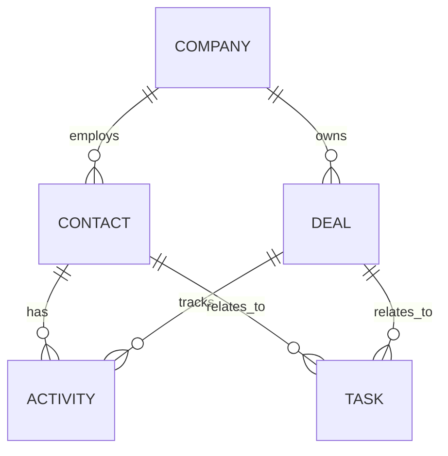

# DeeDee architecture

## Implemented foundation

Company/contact domain models, SQLite migration and repositories, versioned CRUD
API with search/pagination, selected-record context preview, and mock summaries
are now runnable. See [foundation lesson](foundation.md) for exact behavior.
Other modules described below remain planned. The current package uses
`src/deedee/` with separate domain, persistence, schema, service, and API modules;
the broader source layout is a future extension.

## Goal

DeeDee is a small, local-first CRM that makes AI assistance useful without giving an AI unrestricted access to the workspace. The first version is a single-user learning app with a Python API and SQLite. Keep module boundaries ready for future multi-user work without implementing SaaS infrastructure in the first milestone.

## Components

- **Web UI:** CRM screens, AI settings, context preview, and suggestion approval.
- **FastAPI API:** versioned CRUD and explicit AI-action endpoints.
- **Application services:** use cases such as creating a deal or generating a summary.
- **Domain:** CRM entities and rules, independent of infrastructure.
- **Repositories:** persistence interface, implemented first with SQLite.
- **Context builder:** queries only selected records and produces an auditable AI input.
- **Provider gateway:** deterministic mock by default; optional BYOK adapters.
- **Review queue:** stores pending suggestions until a person approves, edits, or rejects them.

## Request flow

1. The user selects an AI action and CRM records.
2. The API verifies access and asks the context builder for only the necessary fields.
3. The UI previews the context; the user confirms the request.
4. The provider gateway calls the configured mock or BYOK adapter.
5. The workflow validates the result and links it to source record IDs.
6. The UI displays the suggestion for review.
7. Only a separate user-approved action writes the change through normal domain services.

## Data model



Initial entities:

- **Company:** identity and organization details.
- **Contact:** person and optional company relationship.
- **Deal:** opportunity, stage, value, and expected close date.
- **Activity:** dated note, call, or meeting linked to one or more records.
- **Task:** due follow-up with status and links to related records.
- **AISuggestion:** proposed summary, task, or draft with source IDs, status, and review timestamps. Store the minimum needed to support review.

All records belong to a local workspace boundary, even in the single-user version. This avoids designing around globally shared records if a future multi-tenant extension is added.

## Suggested source layout

```text
apps/
  api/
  web/
packages/
  domain/
  application/
  persistence/
  ai_gateway/
  security/
docs/
  architecture.md
  modules.md
  roadmap.md
  security-byok.md
examples/
  demo_crm.json
tests/
```

A Python-first implementation can keep these packages in one repository. The frontend remains a separate app and may use any framework that consumes the API.

## Extension points

- Add a new model provider by implementing the provider contract.
- Add a database by implementing repository interfaces and migrations.
- Add workspace membership and roles after the local single-user flow works.
- Add email/calendar integrations as explicit modules with separate consent and permissions.

Do not make the first release depend on multi-agent orchestration, vector search, background jobs, or external integrations.
